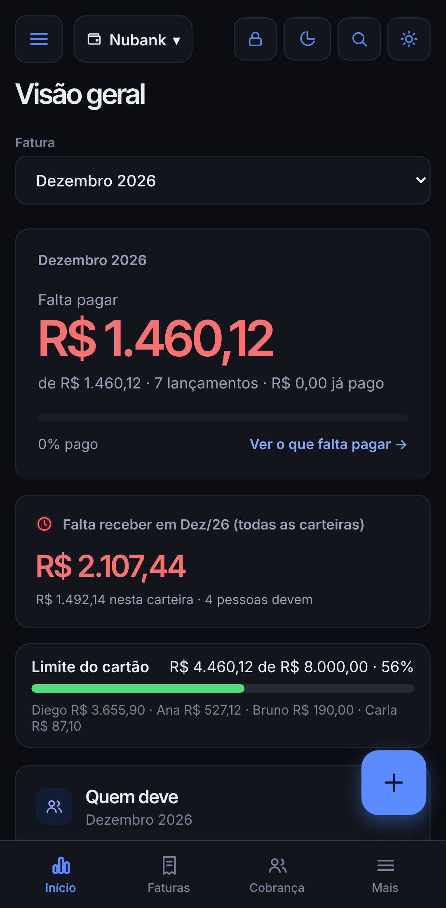
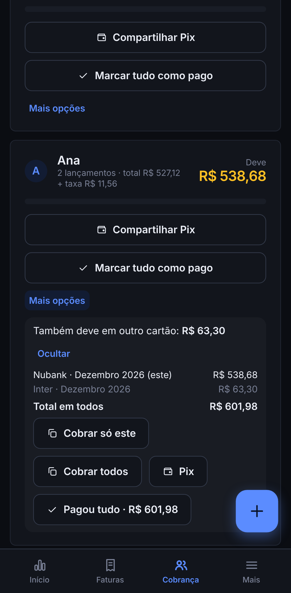
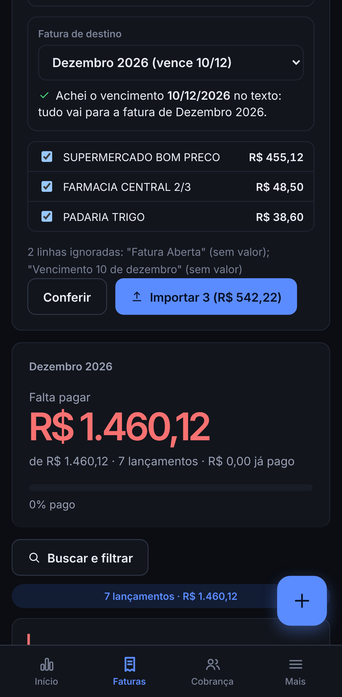
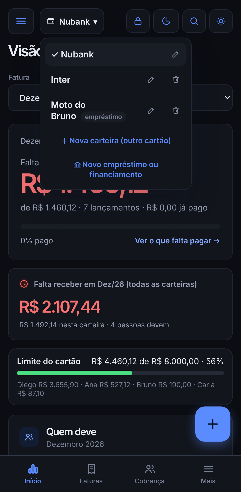
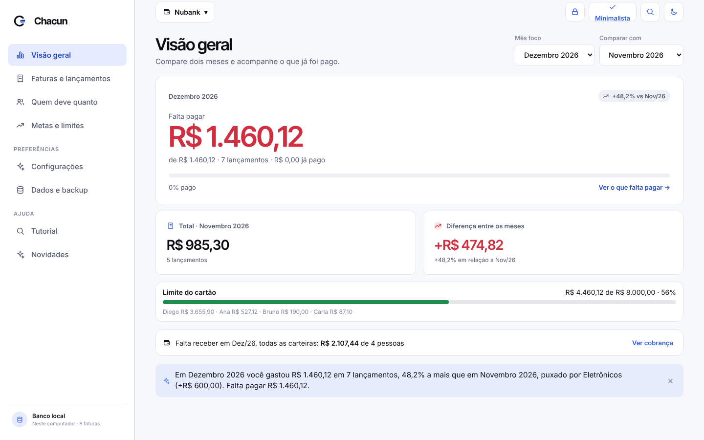

<div align="center">


# Chacun

**Cada um na sua parte.**
Divida a fatura do cartão com a família ou os amigos, saiba quem deve quanto e cobre com um Pix pronto.

[**Usar no navegador**](https://gushrsgh.github.io/organizacao-credito/) · [**Baixar para Android**](https://github.com/GusHRSGH/organizacao-credito/releases/latest) · [Windows](#onde-usar)

<br />






<sub>Prints com pessoas e valores de exemplo.</sub>

</div>

---

## Pra que serve

Você empresta o cartão para a família ou divide as contas com alguém, e todo mês é a mesma coisa: abrir a fatura, separar o que é de quem, somar, mandar mensagem e lembrar quem já pagou. O Chacun faz isso por você.

## Como funciona

1. **Lance as compras.** Digite uma frase (`mercado 150,90 3x @ana`), cole as linhas da fatura, mande um print do app do banco ou importe o CSV/PDF. O app reconhece valor, data, parcelas e quem costuma comprar em cada loja.
2. **Veja quem deve quanto.** Cada pessoa tem a parte dela da fatura, com a taxa do cartão dividida de forma justa e o que ela ainda deve em outros cartões.
3. **Cobre e marque como pago.** Um toque manda o Pix copia e cola com o valor certo ou a mensagem com cada compra pelo WhatsApp. Quando a pessoa paga, um toque marca tudo.

## O que tem

**Lançar**
- Frase rápida, formulário, colar texto ou notificação do banco, prints (vários de uma vez), PDF, CSV do banco e planilha .xlsx. Nada é duplicado.
- O app descobre a fatura pelo vencimento e manda cada parcela para o mês certo.
- Despesas fixas (Netflix, academia) que entram sozinhas todo mês.

**Cobrar**
- Pix copia e cola com o valor de cada pessoa e mensagem pronta para o WhatsApp.
- Vários cartões e empréstimos: cobre só um cartão ou tudo que vence no mês, somado.
- "Pagou um valor": o app acha quais compras foram pagas. Se a pessoa pagar a mais, a sobra vira crédito para a próxima.
- Taxa do cartão (anuidade, por exemplo) dividida conforme o gasto de cada um.

**Acompanhar**
- Visão geral do mês, comparação entre meses e gráficos por pessoa e categoria.
- Limite do cartão: quanto está usado e por quem, com aviso perto de estourar.
- Quem paga em dia e quem costuma atrasar (só você vê).
- Avisos de vencimento e metas de gasto.

**Seus dados**
- Ficam no seu aparelho. Conta na nuvem (com e-mail) é opcional, para usar em mais de um aparelho.
- Backup em arquivo, cópias automáticas para desfazer e bloqueio do app.
- Modo minimalista ou detalhado, tema claro e escuro.

<p align="center">
  
  
</p>

## Onde usar

| | Como |
|---|---|
| **Navegador** (celular ou computador) | Abra [gushrsgh.github.io/organizacao-credito](https://gushrsgh.github.io/organizacao-credito/). Não precisa instalar. |
| **Android** | Baixe o `.apk` da [última versão](https://github.com/GusHRSGH/organizacao-credito/releases/latest) e instale. As próximas versões instalam por cima, sem perder nada. |
| **Windows** | Na aba **Actions**, abra a execução mais recente de **Build Windows installer** e baixe `organizacao-credito-windows`. Se o Windows avisar sobre editor desconhecido, clique em **Mais informações** e **Executar assim mesmo**. |

Gratuito e sem anúncios.

<details>
<summary><b>Para desenvolvedores</b></summary>

<br />

React 19, TypeScript e Vite, com Capacitor (Android), Electron (Windows) e IndexedDB. A nuvem opcional usa o Supabase. Os gráficos são SVG feito à mão e a leitura de prints (Tesseract) roda no próprio aparelho.

```sh
npm install
npm run dev            # versão web
npm test               # testes unitários (Vitest)
npx playwright test    # testes de tela, no celular e no computador
npm run lint && npm run build
```

Os prints deste README são gerados com dados fictícios:

```sh
npx vite-node scripts/demo-backup.ts                 # gera e2e/fixtures/demo-backup.json
README_SHOTS=1 npx playwright test e2e/readme.spec.ts  # tira os prints em docs/screenshots
```

A interface só conversa com a interface `DataSource` (`src/types.ts`). Decisões e estado do projeto ficam em [STACK.md](STACK.md), [PROJECT_STATUS.md](PROJECT_STATUS.md) e [docs/REGRAS-DO-PROJETO.md](docs/REGRAS-DO-PROJETO.md).

</details>

---

## English

**Chacun** ("each one" in French) splits a shared credit card bill. Add purchases by typing a short phrase, pasting bank lines or a screenshot of your bank app, or importing CSV/PDF. Chacun shows what each person owes across all cards and loans and sends a ready-to-pay Pix code or a WhatsApp message. Data stays on your device, with optional cloud sync.

[Open in the browser](https://gushrsgh.github.io/organizacao-credito/) · [Android APK](https://github.com/GusHRSGH/organizacao-credito/releases/latest)
