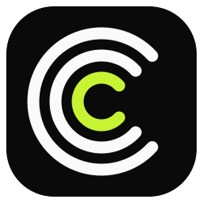
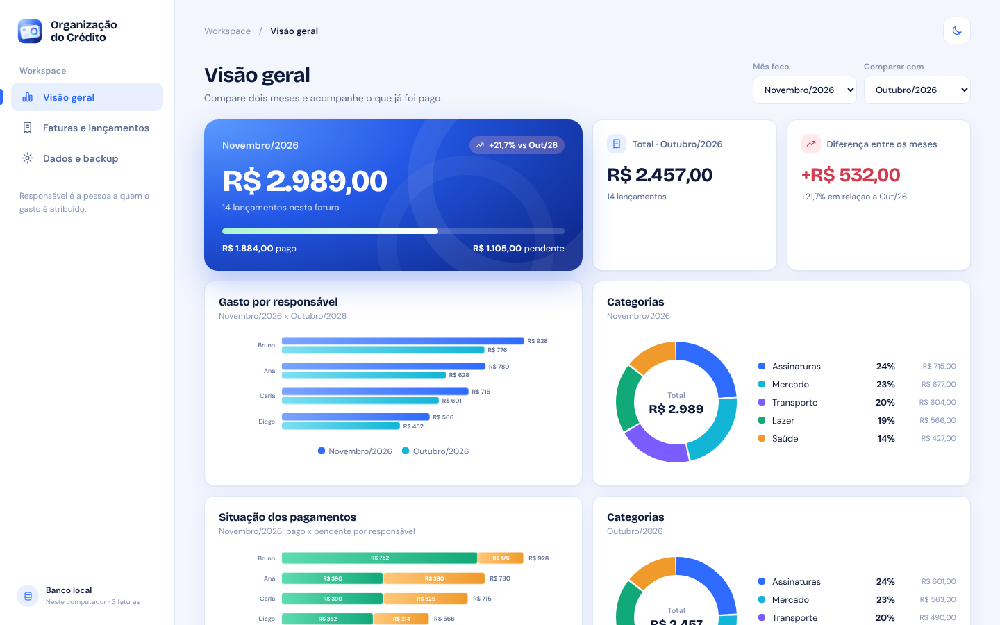
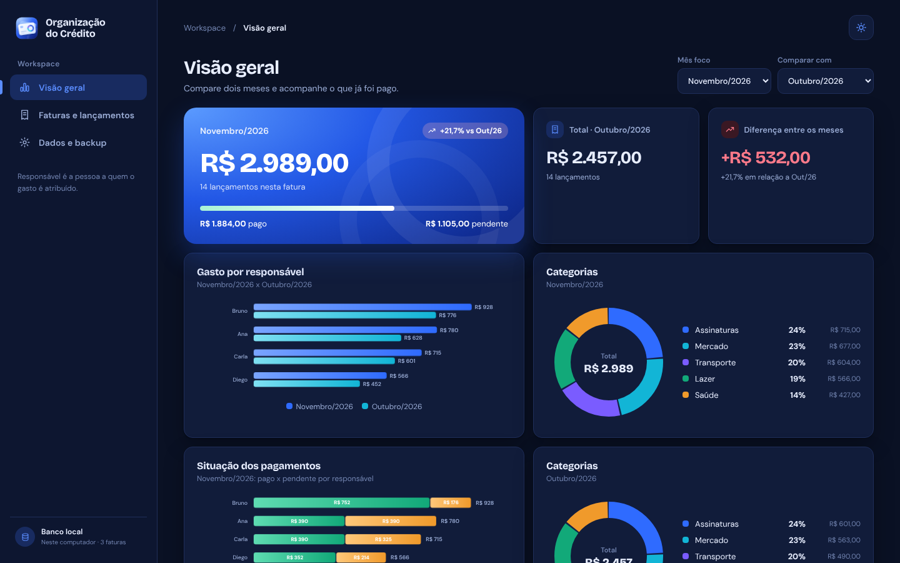
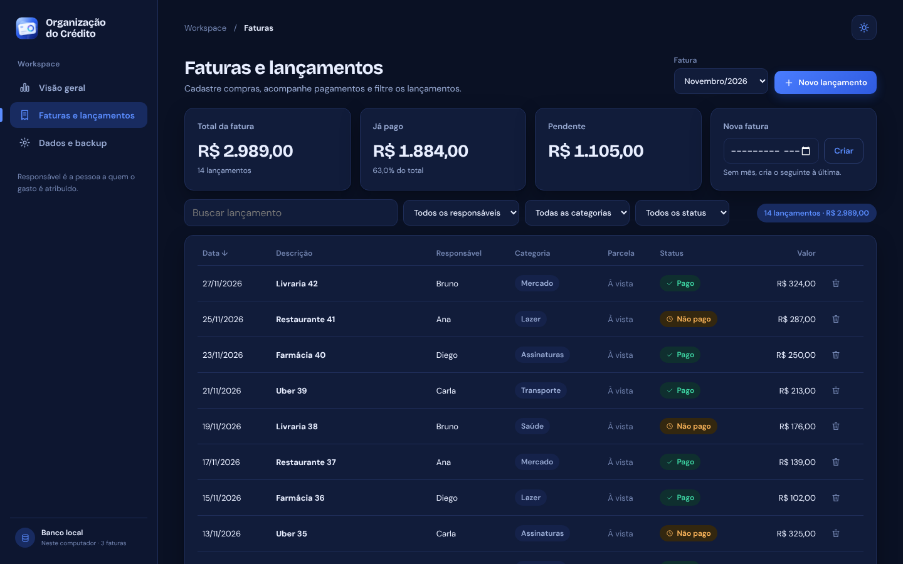

<div align="center">



# Organização do Crédito

**Acompanhe suas faturas de cartão, compare meses e guarde um backup no seu Google Drive.**

Aplicativo para Windows, gratuito, com dados guardados no próprio computador.

[Português](#português) · [English](#english)



</div>

---

## Português

### O que faz

- **Visão geral** com o total da fatura, quanto já foi pago, comparação com outro mês e gráficos por responsável e por categoria.
- **Lançamento rápido**: digite uma linha como `mercado 150,90 3x @ana #casa ontem` e dê Enter (atalho Ctrl+N). O app sugere responsável e categoria pelo seu histórico e lembra os últimos usados.
- **Colar da fatura do banco**: cole as linhas copiadas do app ou site do banco, confira a prévia e importe de uma vez, sem duplicar.
- **Faturas e lançamentos**: cadastro de compras à vista e parceladas (o total é dividido em parcelas mensais iguais e os centavos que sobram vão para a última), filtros e controle de pago ou pendente.
- **Importação da planilha .xlsx** com prévia antes de gravar. Reimportar é seguro, pois lançamentos idênticos são ignorados.
- **Exportação** em CSV (abre no Excel) e **backup** completo em JSON.
- **Login com Google** opcional, com backup automático em uma pasta oculta e exclusiva do app no seu Drive. O app também funciona sem login.
- **Tema claro e escuro**, ícones animados e interface que se adapta a telas menores.
- Dados no **banco local** do computador, sem servidor e sem internet.

<p align="center">
  
  
</p>

### Instalar

1. Abra a aba **Actions** do repositório, entre na execução mais recente de **Build Windows installer** e baixe o artefato `organizacao-credito-windows` (fica disponível por 14 dias).
2. Extraia o zip e execute o `Setup`. O Windows pode avisar sobre editor desconhecido, porque o instalador não tem assinatura paga: clique em **Mais informações** e depois em **Executar assim mesmo**.

### Login com Google e backup

O login usa o fluxo OAuth para apps de computador, com PKCE, no navegador do sistema. Os tokens ficam no processo principal do Electron, criptografados com o armazenamento seguro do Windows, e nunca chegam à interface. O único acesso pedido é o escopo `drive.appdata`: uma pasta oculta do próprio app, sem acesso aos outros arquivos do Drive.

Para gerar o próprio build com o login de um clique, crie um cliente OAuth do tipo **App para computador** no Google Cloud (gratuito) e salve o ID e a chave em `electron/google-client.json` (modelo em `electron/google-client.example.json`). Esse arquivo é ignorado pelo git e nunca deve ser publicado. No GitHub Actions, use os secrets `GOOGLE_CLIENT_ID` e `GOOGLE_CLIENT_SECRET`. Sem o arquivo, o app mostra um guia para cadastrar a chave pela própria tela.

### Desenvolvimento

Requer Node.js 22+ e npm.

```sh
npm install
npm run dev            # versão web, no navegador
npm run desktop:dev    # janela Electron com recarga automática
npm test               # testes de domínio (parcelas, comparações, backup)
npm run lint && npm run build
npm run desktop:dist   # instalador NSIS em release/ (no Windows)
```

**Tecnologias:** React 19, TypeScript, Vite, Electron, IndexedDB, Vitest. Gráficos feitos à mão em SVG, sem biblioteca de gráficos.

**Estrutura:** a interface conversa apenas com a interface `DataSource` (`src/types.ts`). Hoje existem o banco local e uma fonte Supabase opcional, ainda não validada. Isso deixa espaço para outras fontes, como o Google Sheets, que está nos planos.

**Custo:** o projeto precisa custar R$ 0. Veja [STACK.md](STACK.md) e [PROJECT_STATUS.md](PROJECT_STATUS.md) para decisões, estado e pendências.

---

## English

### What it does

- **Overview** with the invoice total, how much is already paid, a comparison against another month, and charts by person and by category.
- **Quick entry**: type a line like `mercado 150,90 3x @ana #casa ontem` and press Enter (shortcut Ctrl+N). The app suggests person and category from your history and remembers the last ones used.
- **Paste from your bank statement**: paste the lines copied from your bank's app or site, review the preview, and import in one go without duplicates.
- **Invoices and transactions**: one-off and installment purchases (the total is split into equal monthly installments, with leftover cents going to the last one), filters, and paid or pending tracking.
- **Spreadsheet import (.xlsx)** with a preview before anything is saved. Re-importing is safe, since identical transactions are skipped.
- **Export** to CSV (opens in Excel) and a full **JSON backup**.
- Optional **Google sign-in** with automatic backup to a hidden, app-only folder in your Drive. The app also works without signing in.
- **Light and dark themes**, animated icons, and a layout that adapts to smaller screens.
- Data lives in the computer's **local database**: no server and no internet needed.

### Install

1. Open the repository's **Actions** tab, pick the latest **Build Windows installer** run, and download the `organizacao-credito-windows` artifact (kept for 14 days).
2. Unzip it and run the `Setup`. Windows may warn about an unknown publisher because the installer is not signed with a paid certificate: click **More info**, then **Run anyway**.

### Google sign-in and backup

Sign-in uses the OAuth flow for desktop apps with PKCE, in the system browser. Tokens stay in Electron's main process, encrypted with Windows secure storage, and never reach the UI. The only access requested is the `drive.appdata` scope: a hidden folder owned by the app, with no access to your other Drive files.

To build your own copy with one-click sign-in, create an OAuth client of type **Desktop app** in Google Cloud (free) and save its ID and secret to `electron/google-client.json` (template in `electron/google-client.example.json`). That file is git-ignored and must never be published. In GitHub Actions, use the `GOOGLE_CLIENT_ID` and `GOOGLE_CLIENT_SECRET` secrets. Without the file, the app shows an in-app guide to enter the key.

### Development

Requires Node.js 22+ and npm.

```sh
npm install
npm run dev            # web version, in the browser
npm run desktop:dev    # Electron window with live reload
npm test               # domain tests (installments, comparisons, backup)
npm run lint && npm run build
npm run desktop:dist   # NSIS installer in release/ (on Windows)
```

**Stack:** React 19, TypeScript, Vite, Electron, IndexedDB, Vitest. Charts are hand-built SVG, with no charting library.

**Architecture:** the UI only talks to the `DataSource` interface (`src/types.ts`). Today there is the local database and an optional Supabase source that has not been validated yet. This leaves room for other sources, such as Google Sheets, which is planned.

**Cost:** the project must cost R$ 0. See [STACK.md](STACK.md) and [PROJECT_STATUS.md](PROJECT_STATUS.md) for decisions, status, and pending work.
